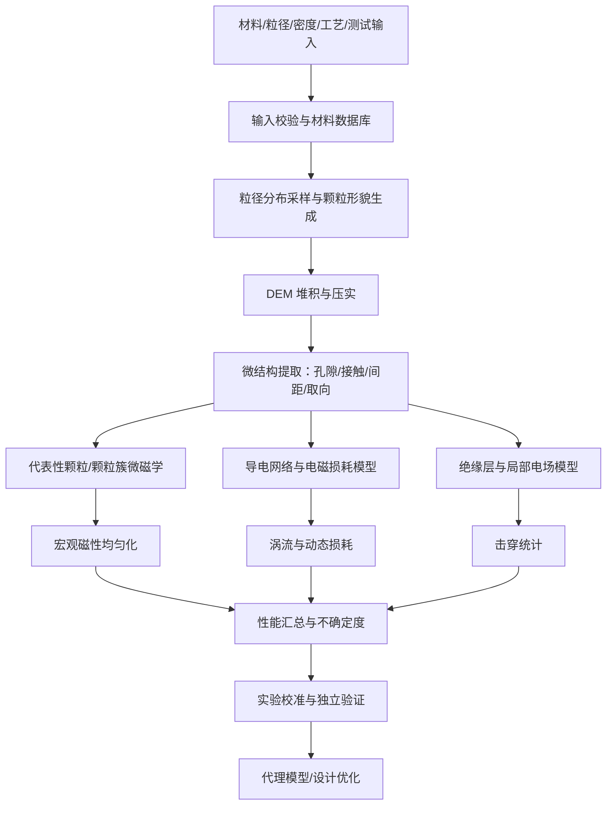

# 基于 Python + Julia + DEM + 微磁学的软磁粉芯多尺度电磁性能预测研究方案

> **文档版本：** V1.0  
> **编制日期：** 2026-10-23  
> **研究对象：** 以 FeSiCr 压制软磁粉芯为首个验证体系，后续可扩展至 FeNi、FeSiAl 等软磁粉末体系  
> **核心技术：** Python + Julia + DEM（离散元）+ MicroMagnetic.jl + 电磁/电场数值模型 + 实验校准  
> **文档性质：** 研究方案与软件架构设计，不是已经完成实验验证的性能预测模型

---

## 摘要

本研究拟建立一个面向压制软磁粉芯的多尺度建模与性能预测平台。用户输入磁粉粒径及粒径分布、材料组成与磁性参数、粉芯堆积密度、绝缘包覆参数及测试条件，平台逐步预测宏观磁滞回线（B–H）、有效磁导率、饱和磁化/磁通特性、磁滞损耗、涡流损耗、总损耗，以及绝缘耐压或击穿强度的统计分布。

方案采用分层建模而不是单一求解器包办所有物理过程：

1. **材料与实验数据层**：统一材料参数、单位、工艺历史和实验元数据。
2. **颗粒结构层**：使用 DEM 生成颗粒堆积、接触网络和孔隙结构。
3. **微观磁学层**：使用 Julia 及 MicroMagnetic.jl 研究代表性颗粒/颗粒簇的磁化过程、磁化反转与磁滞行为。
4. **电磁损耗层**：结合解析模型、导电网络和必要的有限元模型，计算颗粒内部涡流与颗粒间导电路径造成的损耗。
5. **介电耐压层**：通过电场求解、绝缘缺陷模型和统计击穿模型预测耐压分布。
6. **均匀化、校准与代理模型层**：将微观结果映射为粉芯宏观性能，并通过独立实验数据验证和修正。

本研究最重要的科学约束是：**仅凭平均粒径、材料名称和堆积密度，无法唯一确定 B–H 曲线、损耗或耐压。** 至少还需要饱和磁化强度、交换刚度、各向异性、颗粒形貌、绝缘层厚度和完整性、电阻率、应力、热处理历史、激励频率与磁通摆幅等信息。若输入不完整，系统应给出范围、敏感性和不确定度，而不应输出没有依据的单一精确值。

---

## 目录

1. [研究背景与目标](#1-研究背景与目标)
2. [研究范围、假设与输入输出定义](#2-研究范围假设与输入输出定义)
3. [总体技术路线与软件架构](#3-总体技术路线与软件架构)
4. [输入参数与材料数据库设计](#4-输入参数与材料数据库设计)
5. [DEM 颗粒堆积与微结构重建](#5-dem-颗粒堆积与微结构重建)
6. [MicroMagnetic.jl 微磁学建模](#6-micromagneticjl-微磁学建模)
7. [宏观 B–H 曲线与有效磁导率均匀化](#7-宏观-bh-曲线与有效磁导率均匀化)
8. [磁滞损耗、涡流损耗与总损耗](#8-磁滞损耗涡流损耗与总损耗)
9. [绝缘耐压与击穿统计模型](#9-绝缘耐压与击穿统计模型)
10. [Python + Julia 项目实现方案](#10-python--julia-项目实现方案)
11. [首个可运行原型代码](#11-首个可运行原型代码)
12. [实验验证、参数反演与不确定度](#12-实验验证参数反演与不确定度)
13. [研究计划、阶段成果与验收标准](#13-研究计划阶段成果与验收标准)
14. [主要风险、局限性与改进方向](#14-主要风险局限性与改进方向)
15. [推荐文献、软件和数据资源](#15-推荐文献软件和数据资源)
16. [结论与优先级建议](#16-结论与优先级建议)
17. [附录 A：建议输入文件模板](#附录-a建议输入文件模板)
18. [附录 B：结果数据格式](#附录-b结果数据格式)
19. [附录 C：术语与单位](#附录-c术语与单位)

---

## 1. 研究背景与目标

### 1.1 研究背景

软磁粉芯由软磁颗粒、颗粒表面绝缘层以及颗粒间孔隙/接触区域构成。与块体软磁材料相比，粉芯的宏观性能不仅取决于磁性合金本身，还显著受颗粒粒径分布、形状、堆积方式、绝缘层连续性、压制应力和热处理过程影响。

本项目希望建立一个能够连接“粉末设计—颗粒堆积—微观磁化—宏观电磁性能”的预测框架，优先研究：

- 粒径与粒径分布对有效磁导率、磁滞损耗和涡流损耗的影响；
- 材料本征磁参数与颗粒形貌、退磁场和颗粒间相互作用的关系；
- 堆积密度、孔隙率和接触网络对宏观 B–H 曲线及电流路径的影响；
- 绝缘层厚度与缺陷对颗粒间电流和击穿风险的影响；
- 如何利用有限的实验数据校准模型，并形成可以快速扫描参数的代理模型。

### 1.2 研究目标

最终建立的软件应具备以下能力：

1. 输入材料参数、粒径分布、目标堆积密度和测试条件；
2. 生成或导入具有代表性的颗粒微结构；
3. 计算或估计粉芯宏观 B–H 曲线、有效磁导率、饱和特性；
4. 分别估计磁滞损耗、颗粒内部涡流损耗和跨颗粒导电造成的额外损耗；
5. 对绝缘耐压给出有明确假设的估计或概率分布；
6. 输出预测值、参数来源、模型假设、误差范围及适用条件；
7. 通过新实验数据更新材料参数和代理模型。

### 1.3 研究问题拆分

| 编号 | 科学问题 | 主要方法 | 可验证结果 |
|---|---|---|---|
| Q1 | 粒径和形状如何影响单颗粒磁化反转？ | 微磁学 | 单颗粒 M–H 回线、反转场 |
| Q2 | 颗粒堆积和磁相互作用如何影响有效磁性能？ | DEM + 微磁学/磁路/有限元 | 粉芯 B–H、有效磁导率 |
| Q3 | 粒径分布如何影响涡流损耗？ | 解析模型 + 电磁场模型 | 频率、粒径与损耗关系 |
| Q4 | 绝缘层缺陷如何导致颗粒间导电？ | 接触网络 + 电阻网络 + 电场模型 | 等效电阻、跨颗粒损耗 |
| Q5 | 堆积结构如何影响击穿？ | 电场 FEM + 随机缺陷 + 统计模型 | 击穿电压分布 |
| Q6 | 如何以有限实验数据完成可靠校准？ | 参数反演、敏感性分析、独立验证 | 预测误差与置信区间 |

---

## 2. 研究范围、假设与输入输出定义

### 2.1 首阶段材料体系

建议先聚焦 **FeSiCr 压制软磁粉芯**。原因是它适合作为粉末软磁复合材料的研究对象，并且便于围绕颗粒粒径、绝缘包覆、压制密度和频率特性设计对照实验。该选择是项目范围建议，不代表 FeSiCr 一定优于其他材料。

后续可扩展：

- FeNi 类粉末；
- FeSiAl 类粉末；
- 其他铁基合金粉末；
- 片状粉末或具有明显各向异性的颗粒；
- 经退火、包覆、表面处理或不同压制工艺处理的粉芯。

### 2.2 建议输入与输出

| 类别 | 输入或输出变量 | 符号/单位 | 备注 |
|---|---|---|---|
| 输入 | 粒径分布 | \(d\)，m 或 μm | 建议使用分位数或分布直方图，而非仅平均粒径 |
| 输入 | 颗粒形貌 | 球形、椭球、实测网格 | 影响堆积、退磁场与接触 |
| 输入 | 饱和磁化强度 | \(M_s\)，A/m | 微磁学关键参数 |
| 输入 | 交换刚度 | \(A\)，J/m | 微磁学关键参数 |
| 输入 | 各向异性常数 | \(K\)，J/m³ | 需说明晶体/有效各向异性定义 |
| 输入 | 磁致伸缩系数 | \(\lambda_s\)，无量纲 | 应力敏感性分析需要 |
| 输入 | 电阻率 | \(\rho_e\)，Ω·m | 区分颗粒材料和粉芯等效电阻率 |
| 输入 | 目标体积密度 | \(\rho_{\mathrm{bulk}}\)，kg/m³ | 成品质量/总体积 |
| 输入 | 磁性相体积分数 | \(\phi_m\)，无量纲 | 不等同于所有情况下的相对密度 |
| 输入 | 绝缘层厚度 | \(t_{\mathrm{ins}}\)，m | 建议输入分布及缺陷率 |
| 输入 | 激励频率 | \(f\)，Hz | 测试或应用条件 |
| 输入 | 磁通密度摆幅 | \(B_{\mathrm{pk}}\) 或 \(\Delta B\)，T | 必须明确峰值、峰峰值或单边摆幅 |
| 输出 | 宏观磁滞回线 | \(B(H)\) | 需定义试样几何和退磁修正 |
| 输出 | 有效磁导率 | \(\mu_{\mathrm{eff}}\) 或 \(\mu_r\) | 应说明初始、增量或复磁导率 |
| 输出 | 饱和指标 | \(M_s\)、\(B_s\) 或指定判据下的 \(B\) | 不同定义不可混用 |
| 输出 | 磁滞损耗 | W/m³ 或 W/kg | 标明归一化基准 |
| 输出 | 涡流损耗 | W/m³ 或 W/kg | 标明模型适用条件 |
| 输出 | 总损耗 | W/m³、W/kg 或 W | 需避免重复计数 |
| 输出 | 耐压/击穿 | V、V/mm 或概率分位数 | 需要测试条件与统计定义 |
| 输出 | 不确定度 | 置信区间/预测区间 | 输入不完整时尤其重要 |

### 2.3 必须区分的密度

“堆积密度”在实际项目中可能有多种定义，数据接口必须明确：

1. **粉末松装密度**：未压实粉末的单位总体积质量。
2. **振实密度**：经规定振动/敲击后的单位总体积质量。
3. **成品粉芯体积密度**：成品质量除以成品几何总体积。
4. **材料真密度**：固体材料自身密度。
5. **磁性相体积分数**：磁性固相体积占粉芯总体积的比例。

若粉芯包含磁性颗粒、绝缘包覆、孔隙和其他添加相，则一般不能直接把成品体积密度除以磁性材料密度就视为精确磁性体积分数，除非各相的质量、密度和体积定义均已明确。

### 2.4 输入不完整时的处理原则

系统不应因为输入不完整而停止整个研究，但应明确输出状态：

- **可直接计算**：单位、几何、已知材料参数足以支持的解析量；
- **条件预测**：依赖明确假设或典型参数范围的结果；
- **需要校准**：需用实验拟合的参数或模型；
- **暂不可预测**：关键数据缺失，无法给出有意义的绝对数值。

每一项输出应携带 `model_status`、参数来源、假设和不确定度字段。

---

## 3. 总体技术路线与软件架构

### 3.1 多尺度工作流



### 3.2 建模层级

| 层级 | 目标 | 建议模型 | 计算成本 |
|---|---|---|---|
| L0：解析基线 | 快速判断趋势、排查单位错误 | 解析公式、混合模型 | 低 |
| L1：结构感知 | 将堆积结构纳入预测 | DEM + 磁路/网络模型 | 中 |
| L2：局部高保真 | 解析磁化、场集中与缺陷效应 | 微磁学、局部 FEM | 高 |
| L3：宏观校准 | 对真实材料预测性能 | 实验反演、统计模型 | 取决于数据量 |
| L4：代理预测 | 快速参数扫描和优化 | 高斯过程、随机森林、神经网络等 | 训练成本中高、预测成本低 |

推荐的工程策略是：用 L0/L1 运行大规模参数扫描，用 L2 解释关键机制并校准，用 L3 评估真实误差，再用 L4 加速设计迭代。

### 3.3 Python 与 Julia 的职责

**Python 建议承担：**

- 输入参数校验、单位管理、数据清洗；
- DEM 工作流调度和几何后处理；
- 导电网络、解析损耗与电场模型的外围处理；
- 实验拟合、统计分析、绘图与报告生成；
- 参数敏感性、优化和代理模型。

**Julia 建议承担：**

- MicroMagnetic.jl 微磁学模拟；
- 大规模参数扫描或需要高性能数值实现的任务；
- 微磁学结果导出与回线后处理；
- 未来可选的自定义多尺度算法。

初期建议使用 JSON/CSV 作为 Python 与 Julia 的稳定接口，不要先把精力花在复杂的进程内绑定上。文件接口便于复现、调试和替换组件。待核心算法稳定后，再评估 JuliaCall、PyJulia 或命令行批处理等集成方案的兼容性。

---

## 4. 输入参数与材料数据库设计

### 4.1 材料数据库

每种材料应建立独立记录，不要仅用材料名称代表所有参数。建议字段如下：

| 字段 | 含义 | 数据来源 |
|---|---|---|
| `material_id` | 唯一材料编号 | 项目内部生成 |
| `composition` | 化学成分与范围 | 供应商/成分测试/文献 |
| `Ms_A_m` | 饱和磁化强度 | 实测或可追溯文献 |
| `A_J_m` | 交换刚度 | 实测、可靠文献或反演 |
| `K_J_m3` | 各向异性常数 | 实测/文献/模型 |
| `alpha` | 阻尼参数 | 文献或校准 |
| `lambda_s` | 磁致伸缩系数 | 实测或文献 |
| `rho_e_ohm_m` | 电阻率 | 实测，注明温度 |
| `density_kg_m3` | 真密度 | 实测或供应商 |
| `grain_size_m` | 晶粒尺寸 | 显微表征 |
| `heat_treatment` | 热处理条件 | 工艺记录 |
| `source_type` | 实测/文献/估计 | 必填 |
| `source_ref` | DOI、报告或数据文件 | 必填 |
| `uncertainty` | 参数误差或范围 | 尽可能填写 |

**重要原则：** 微磁学输入参数对结果可能非常敏感。不能仅因为两个材料都叫 FeSiCr，就认为它们具有相同的 \(M_s\)、\(A\)、\(K\)、电阻率和磁致伸缩参数。

### 4.2 粒径分布

不建议仅输入平均粒径。至少支持：

- 粒径分位数：D10、D50、D90；
- 数量分布或体积分布的定义；
- 单分散、多分散或双峰分布；
- 颗粒形状与长宽比；
- 测量方法及分散状态。

数量分布和体积分布不能直接混用。对于球形颗粒，单颗粒体积与 \(d^3\) 成正比，因此少量大颗粒可能对体积分数、堆积和涡流损耗贡献较大。

### 4.3 参数来源分级

建议为每个参数增加证据等级：

- **A 级：** 本项目对目标材料和目标工艺的直接实测；
- **B 级：** 同一材料体系、可追溯且测试条件明确的文献数据；
- **C 级：** 相近材料或相近工艺的参考数据；
- **D 级：** 为程序调试设置的假设值。

D 级参数只能用于代码验证或敏感性分析，不能用于声称真实材料的预测精度。

---

## 5. DEM 颗粒堆积与微结构重建

### 5.1 DEM 的任务

DEM（Discrete Element Method，离散元法）用于模拟颗粒的平移、旋转、接触、摩擦和压实。其输出是后续磁学、电学和介电模型所需的几何基础，而不是直接的磁性能结果。

建议的输出包括：

- 每个颗粒的 ID、中心坐标、尺寸、形状与取向；
- 接触颗粒对、接触点、接触力与接触法向；
- 局部配位数；
- 孔隙率及孔隙空间分布；
- 颗粒间表面间距；
- 压实前后的结构变化；
- 是否达到目标体积密度及结构收敛情况。

### 5.2 DEM 软件选型

可评估以下工具，具体版本、操作系统兼容性和许可证应在实施前确认：

| 工具 | 定位 | 优点 | 需要注意 |
|---|---|---|---|
| YADE | 开源离散元平台 | 可扩展、适合颗粒接触力学研究 | 安装环境和脚本接口需按版本确认 |
| LIGGGHTS | 基于 LAMMPS 的颗粒模拟框架 | 适合大规模颗粒与接触模拟 | 维护状态、构建方式和版本兼容需核查 |
| 自定义简化 DEM | 原型与特定接触模型 | 易于掌控数据格式和模型假设 | 需自行验证数值稳定性和接触模型 |

建议先使用成熟 DEM 软件完成颗粒生成与压实；只有在标准软件难以表达所需接触模型时，才自行实现完整 DEM。

### 5.3 DEM 流程

1. 从指定粒径分布抽样颗粒；
2. 在模具边界内生成初始颗粒；
3. 消除严重重叠并达到初始稳定状态；
4. 逐步压实或施加目标载荷；
5. 检查总能量、接触力、密度与结构是否收敛；
6. 导出颗粒和接触数据；
7. 用实际粉芯密度、截面图像或 CT 数据校验。

### 5.4 颗粒接触模型

DEM 接触模型至少应考虑：

- 法向接触刚度；
- 切向接触与摩擦；
- 恢复系数或阻尼；
- 颗粒形状；
- 模具边界条件；
- 压制载荷或位移路径。

但 DEM 中的机械接触并不必然意味着电学导通。实际颗粒表面可能有绝缘包覆、氧化层、局部破损或烧结颈。必须将机械接触与电接触分开建模。

### 5.5 结构校验指标

| 指标 | 校验方法 | 目的 |
|---|---|---|
| 成品体积密度 | 仿真总体积与实验质量/体积比较 | 检查整体压实结果 |
| 粒径分布 | 仿真生成分布与输入分布比较 | 检查采样实现 |
| 配位数分布 | 与显微结构/CT 或可信文献比较 | 检查接触网络 |
| 孔隙率及孔隙分布 | 截面图像或 CT | 检查微结构真实性 |
| 颗粒重叠量 | DEM 数值诊断 | 排查不合理几何 |
| 随机种子敏感性 | 多次独立生成 | 量化微结构随机性 |

### 5.6 代表性体积单元（RVE）

完整粉芯包含的颗粒数量可能很大，不适合逐颗粒进行高分辨率微磁学求解。建议从 DEM 结构中提取代表性体积单元或典型颗粒簇，按不同局部环境分组：

- 高配位数/紧密堆积区域；
- 低配位数/高孔隙区域；
- 不同颗粒间距；
- 不同颗粒尺寸组合；
- 不同绝缘层状态。

RVE 的尺寸必须通过统计收敛测试确定，不能任意选择一个小区域后就认为它代表整块粉芯。

---

## 6. MicroMagnetic.jl 微磁学建模

### 6.1 工具定位

MicroMagnetic.jl 是 Julia 生态中的微磁学与原子自旋模拟工具。项目主页与文档：

- GitHub：<https://github.com/MagneticSimulation/MicroMagnetic.jl>
- 文档：<https://magneticsimulation.github.io/MicroMagnetic.jl/>

正式开发时，应以所安装版本的文档、示例和测试为准，确认网格类型、求解器接口、外场扫描方法、数据导出格式和 GPU 后端支持情况。

### 6.2 微磁学基本模型

连续介质微磁学常以单位磁化方向 \(\mathbf m\) 描述磁化状态：

\[
\mathbf M = M_s \mathbf m,\qquad |\mathbf m|=1
\]

常见能量项包括：

\[
E = E_{\mathrm{ex}}+E_{\mathrm{ani}}+E_{\mathrm{demag}}+
E_{\mathrm{Zeeman}}+E_{\mathrm{me}}+\cdots
\]

其中：

- \(E_{\mathrm{ex}}\)：交换能；
- \(E_{\mathrm{ani}}\)：磁晶或有效各向异性能；
- \(E_{\mathrm{demag}}\)：退磁能；
- \(E_{\mathrm{Zeeman}}\)：外磁场作用能；
- \(E_{\mathrm{me}}\)：在模型中显式考虑时的磁弹性能。

并非每个项目都需要启用全部能量项。应根据材料、尺寸、应力与研究目标逐项说明假设。

常见动力学模型为 Landau–Lifshitz–Gilbert（LLG）方程。其作用是描述磁化随有效磁场的演化。需要注意，LLG 的数值时间尺度、阻尼参数和真实材料的宏观频率损耗之间并不存在无需校准的直接等价关系。

### 6.3 建模任务分级

#### A. 单颗粒模型

目标：建立粒径、形状、各向异性与磁化反转之间的关系。

输入：
- 颗粒几何；
- \(M_s\)、交换刚度 \(A\)、各向异性参数；
- 阻尼参数；
- 外场方向与扫描路径；
- 初始磁化状态。

输出：
- 磁化方向和空间分布；
- 磁化反转过程；
- M–H 回线；
- 矫顽力及反转场；
- 能量项随外场的变化。

#### B. 颗粒簇模型

目标：研究颗粒间磁相互作用。

从 DEM 中提取具有代表性的颗粒簇，保留颗粒中心、形状、尺寸和间距。对不同局部结构进行对比：

- 孤立颗粒；
- 紧密接近的颗粒；
- 具有较大绝缘间隙的颗粒；
- 多分散粒径组合；
- 不同颗粒取向或形状组合。

在初期可把颗粒簇当作磁学 RVE，不必一次性建模整块粉芯。

#### C. 应力与磁弹性

压制过程可能引入残余应力，而磁致伸缩材料可能对其较敏感。若研究目标包含压制压力、退火或应力释放的影响，应逐步引入磁弹性项，或先建立经实验校准的有效各向异性修正模型。

不得把 DEM 接触力直接当作微磁学应力场，除非已经建立从接触力到颗粒内部应力分布的力学模型。

### 6.4 网格与交换长度

微磁学网格需要与材料的交换长度和磁化变化尺度相适应。常见交换长度尺度估算为：

\[
\ell_{\mathrm{ex}} \sim
\sqrt{\frac{2A}{\mu_0 M_s^2}}
\]

此式可用于初步估算特征尺度，但实际网格策略应依据软件定义、能量项、几何和网格收敛测试确定。

**禁止直接把纳米级网格用于整个几十微米颗粒并假设结果可靠。** 对大颗粒、复杂形状和多颗粒系统，应考虑更合理的网格、等效模型、局部模型或多尺度降阶方法。

### 6.5 磁滞回线求解注意事项

正式的回线计算应包含：

1. 初始化磁化状态；
2. 沿指定路径逐步增加外场；
3. 在每个场点进行充分松弛或按指定动力学积分；
4. 扫描至正向饱和或设定的最大场；
5. 反向扫描；
6. 完成完整周期并检查回线闭合；
7. 对场步长、网格和收敛阈值做敏感性分析；
8. 导出 H、M、B 以及必要的能量项。

仅有一次单向外场扫描，不足以构成完整磁滞回线。

### 6.6 从微磁学到宏观磁性能

微磁学通常输出磁化强度 \(M\)，而粉芯宏观测试通常以磁场强度 \(H\) 和磁通密度 \(B\) 表示。真空关系为：

\[
\mathbf B=\mu_0(\mathbf H+\mathbf M)
\]

在复合材料中，宏观平均磁化必须明确采用整个 RVE 体积还是仅磁性相体积归一化。建议同时保存：

- 磁性相平均磁化；
- 整个 RVE 体积平均磁化；
- 外加场；
- 内部有效场或退磁修正；
- 试样几何与边界条件。

由此才能避免把单颗粒本征曲线直接误当作粉芯实测曲线。

---

## 7. 宏观 B–H 曲线与有效磁导率均匀化

### 7.1 三种可选方法

| 方法 | 原理 | 优点 | 局限 |
|---|---|---|---|
| 简化混合模型 | 按磁性体积分数与非磁相进行近似 | 快速、适合趋势研究 | 不能充分描述接触网络和局部磁场 |
| DEM 磁路网络 | 将颗粒和间隙映射为磁阻网络 | 可利用真实堆积结构 | 磁路抽象和饱和处理需要验证 |
| RVE 有限元/场求解 | 在代表性几何中求解场分布 | 物理细节更丰富 | 网格和计算成本高 |

建议先用简化模型和 DEM 磁路网络建立基线，再选取代表性结构与实验进行对比，决定是否有必要投入高保真 RVE 场求解。

### 7.2 有效磁导率

有效磁导率必须明确是：

- 初始磁导率；
- 增量磁导率；
- 割线磁导率；
- 小信号复磁导率；
- 特定直流偏置下的微分磁导率。

对非线性磁芯，不同定义的数值可能明显不同。高频应用还需区分复磁导率实部与虚部。

### 7.3 饱和指标

饱和磁化强度 \(M_s\) 是材料层面的参数，而粉芯的饱和磁通特性还受磁性相体积分数、孔隙、磁路和试样几何影响。建议输出：

1. 材料本征 \(M_s\)；
2. 按整个粉芯体积归一化的饱和磁化估计；
3. 按明确判据定义的宏观 \(B_s\)；
4. 判据与测试方法。

不要把不同文献中采用不同饱和判据得到的数值直接比较。

---

## 8. 磁滞损耗、涡流损耗与总损耗

### 8.1 磁滞损耗

对完整周期的宏观 B–H 回线，每周期单位体积能量损耗为：

\[
W_h=\oint H\,dB
\]

频率为 \(f\) 时，准静态磁滞损耗功率密度可写为：

\[
P_h=f\oint H\,dB
\]

其中 \(W_h\) 单位为 J/m³/周期，\(P_h\) 单位为 W/m³。若要转换为 W/kg，需要除以粉芯体积密度，并确保体积归一化基准一致。

数值积分前应检查：

- 回线是否包含完整闭合周期；
- H 与 B 的单位是否正确；
- 数据是否按实际扫描顺序排列；
- 是否对测量数据做过不恰当平滑；
- 退磁和仪器相位误差是否已经处理。

不能简单将孤立颗粒的回线面积乘以颗粒数量作为粉芯宏观损耗。颗粒相互作用、应力、缺陷、结构和真实材料的不可逆过程均可能改变回线。

### 8.2 经典涡流损耗近似

对孤立、均匀、导电、球形颗粒，在均匀正弦磁场和经典低频近似适用的条件下，可用下式进行初始估算：

\[
\frac{P_e}{V_{\mathrm{particle}}}
\approx
\frac{\pi^2 d^2 f^2 B_p^2}{20\rho_e}
\]

其中：

- \(d\)：球形颗粒直径，m；
- \(f\)：频率，Hz；
- \(B_p\)：正弦磁通密度峰值，T；
- \(\rho_e\)：颗粒电阻率，Ω·m。

该表达式用于初步量级估算，不适用于所有形状、非均匀局部场、强集肤效应或存在跨颗粒电流的情况。工程模型应根据目标频率、颗粒尺寸和电磁场分布判断其适用性。

### 8.3 颗粒内部与颗粒间损耗

应区分：

**颗粒内部涡流**
- 由单颗粒内部的时变磁场引起；
- 与粒径、电导率、频率、磁通摆幅及颗粒形状有关。

**颗粒间电流**
- 由绝缘层不完整、接触导通、裂纹或烧结颈等形成较大尺度回路；
- 取决于接触电阻、导电路径长度、网络拓扑和缺陷分布。

DEM 输出的机械接触对可以为导电网络提供几何候选，但必须另设“电接触状态”变量。不能将所有机械接触默认成电气短路，也不能默认绝缘层完美。

### 8.4 总损耗模型

初始可使用分离损耗框架：

\[
P_{\mathrm{total}}=P_h+P_e+P_{\mathrm{ex}}
\]

其中 \(P_{\mathrm{ex}}\) 表示超额/剩余动态损耗等项。该式是模型框架，具体各项的定义、频率依赖和拟合方式需要与实验测量相匹配。

推荐的损耗研究顺序：

1. 低频或准静态 B–H 回线估算磁滞损耗；
2. 解析模型估算颗粒内部涡流；
3. 通过绝缘完整性与接触网络评估跨颗粒电流；
4. 在多个频率和磁通摆幅下测量总损耗；
5. 用差分或联合拟合估计剩余动态损耗；
6. 在未参与拟合的频率/磁通条件下验证。

不要将高频动态回线积分得到的全部损耗与独立估算的全部涡流损耗直接相加，否则可能重复计数。

---

## 9. 绝缘耐压与击穿统计模型

### 9.1 为什么耐压不能仅由粒径和密度推导

击穿行为与绝缘材料介电强度、绝缘层最薄位置、局部场集中、缺陷、孔隙、颗粒接触状态、试样厚度、电极形状、升压速率和环境条件有关。平均粒径与堆积密度只能提供部分几何信息。

### 9.2 推荐的三层模型

**第 1 层：理想绝缘模型**
- 给定颗粒与绝缘层几何；
- 指定介电常数和电导率；
- 求解静电或准静态电场；
- 观察局部电场集中区域。

**第 2 层：随机缺陷模型**
- 为绝缘层厚度引入空间分布；
- 设置一定概率的针孔、裂纹或局部失效；
- 在颗粒接触处加入不同电学边界条件；
- 多次随机采样并计算局部场。

**第 3 层：击穿统计模型**
- 使用多试样击穿电压数据；
- 拟合适当的统计分布，例如 Weibull 分布（前提是数据支持该假设）；
- 输出指定可靠度或失效率下的击穿电压；
- 使用独立样本检验预测能力。

### 9.3 耐压输出定义

建议至少输出：

- 测试条件下的击穿电压分布；
- 试样厚度归一化后的击穿场强；
- 中位数及低分位数；
- 置信区间；
- 模型适用范围；
- 主要失效模式及证据等级。

仿真最大电场并不等于击穿电压。必须有材料击穿准则和试验数据校准，才能将电场计算转化为工程耐压预测。

---

## 10. Python + Julia 项目实现方案

### 10.1 推荐项目目录

```text
softmag_predictor/
├── README.md
├── pyproject.toml
├── configs/
│   ├── material.yaml
│   ├── dem.yaml
│   ├── micromagnetics.yaml
│   └── experiment.yaml
├── data/
│   ├── raw/
│   └── processed/
├── python/
│   ├── schemas.py
│   ├── particle_generator.py
│   ├── dem_runner.py
│   ├── microstructure.py
│   ├── eddy_loss.py
│   ├── dielectric.py
│   ├── homogenization.py
│   ├── calibration.py
│   └── report.py
├── julia/
│   ├── Project.toml
│   ├── hysteresis.jl
│   ├── particle_cluster.jl
│   └── export_results.jl
├── tests/
│   ├── test_units.py
│   ├── test_eddy_loss.py
│   ├── test_hysteresis_integral.py
│   └── test_data_contract.py
└── results/
    ├── dem/
    ├── hysteresis/
    ├── losses/
    └── dielectric/
```

### 10.2 Python 依赖建议

可先安装通用数据分析依赖：

```bash
python -m venv .venv
# Windows PowerShell
.venv\Scripts\Activate.ps1

python -m pip install --upgrade pip
python -m pip install numpy scipy pandas pyyaml matplotlib pydantic
```

DEM 引擎应单独安装和验证。YADE、LIGGGHTS 等软件可能对操作系统、编译环境或发行版本有特定要求，因此不建议将未经验证的单条安装命令写死在核心项目安装流程中。

### 10.3 Julia 环境

在 Julia 项目目录下执行：

```julia
using Pkg
Pkg.activate(".")
Pkg.add("MicroMagnetic")
Pkg.add("JSON3")
Pkg.add("CSV")
Pkg.add("DataFrames")
Pkg.instantiate()
```

为确保可复现，应将 `Project.toml` 和 `Manifest.toml` 纳入版本控制，并记录 Julia 与 MicroMagnetic.jl 的确切版本。升级依赖前应运行完整回归测试。

### 10.4 Python–Julia 数据契约

建议输入 JSON 至少包含：

- `schema_version`
- `material`
- `geometry`
- `microstructure`
- `solver`
- `excitation`
- `provenance`

Julia 输出至少包含：

- 输入配置的哈希或 ID；
- 软件版本；
- 网格参数；
- 外场扫描路径；
- H、M、B 数据；
- 收敛状态；
- 模型假设和警告；
- 输出文件路径。

这样可以避免结果文件脱离输入参数而无法追溯。

---

## 11. 首个可运行原型代码

本节给出两个原型：Python 解析损耗基线与 Julia 微磁学环境测试。它们用于建立项目骨架，不代表已经完成 DEM、多尺度均匀化或耐压预测。

### 11.1 输入模板

保存为 `configs/material.yaml`：

```yaml
material:
  name: FeSiCr
  particle_diameter_m: 2.0e-5
  particle_density_kg_m3: 7000
  particle_resistivity_ohm_m: 1.0e-6

microstructure:
  magnetic_volume_fraction: 0.75
  insulation_thickness_m: 1.0e-7

excitation:
  frequency_hz: 1000000
  flux_density_peak_T: 0.05
```

**注意：** 上述参数均为程序测试用占位值，不是特定 FeSiCr 粉末的实测数据或推荐值。真实研究中必须替换为目标材料数据，并记录来源和不确定度。

### 11.2 Python 基线程序

保存为 `python/baseline.py`：

```python
from pathlib import Path
import json

import numpy as np
import yaml


def load_config(path):
    with open(path, "r", encoding="utf-8") as f:
        cfg = yaml.safe_load(f)

    m = cfg["material"]
    s = cfg["microstructure"]
    e = cfg["excitation"]

    if m["particle_diameter_m"] <= 0:
        raise ValueError("粒径必须大于 0")
    if m["particle_resistivity_ohm_m"] <= 0:
        raise ValueError("电阻率必须大于 0")
    if not 0 < s["magnetic_volume_fraction"] <= 1:
        raise ValueError("磁性相体积分数必须位于 (0, 1]")
    if e["frequency_hz"] <= 0:
        raise ValueError("频率必须大于 0")
    if e["flux_density_peak_T"] < 0:
        raise ValueError("磁通密度峰值不能为负")

    return cfg


def spherical_particle_eddy_loss_density(
    diameter_m, frequency_hz, flux_peak_T, resistivity_ohm_m
):
    """孤立球形导电颗粒的经典低频涡流损耗近似，单位 W/m^3。"""
    return (
        np.pi**2
        * diameter_m**2
        * frequency_hz**2
        * flux_peak_T**2
        / (20.0 * resistivity_ohm_m)
    )


def hysteresis_loss_density(H_A_m, B_T, frequency_hz):
    """
    由一个完整周期的 H-B 数据计算单位体积平均损耗，单位 W/m^3。
    H 单位 A/m，B 单位 T，频率单位 Hz。
    输入应按一个完整周期的实际扫描顺序排列。
    """
    H = np.asarray(H_A_m, dtype=float)
    B = np.asarray(B_T, dtype=float)

    if len(H) != len(B) or len(H) < 3:
        raise ValueError("H、B 必须等长且至少有 3 个点")
    if frequency_hz < 0:
        raise ValueError("频率不能为负")

    # 闭合周期的数值积分：∮ H dB
    energy_per_cycle = abs(np.sum(
        0.5 * (H[:-1] + H[1:]) * np.diff(B)
    ))
    return float(energy_per_cycle * frequency_hz)


def main():
    cfg = load_config("configs/material.yaml")
    m = cfg["material"]
    s = cfg["microstructure"]
    e = cfg["excitation"]

    p_particle = spherical_particle_eddy_loss_density(
        m["particle_diameter_m"],
        e["frequency_hz"],
        e["flux_density_peak_T"],
        m["particle_resistivity_ohm_m"],
    )

    # 仅为理想颗粒内部涡流模型的初步估算：
    # 假设磁性颗粒体积分数已知，忽略颗粒间电流和局部场差异。
    p_core_ideal = p_particle * s["magnetic_volume_fraction"]

    result = {
        "material": m["name"],
        "eddy_loss_particle_W_m3": p_particle,
        "eddy_loss_core_ideal_W_m3": float(p_core_ideal),
        "frequency_hz": e["frequency_hz"],
        "flux_density_peak_T": e["flux_density_peak_T"],
        "model_status": "analytical_baseline_not_experimentally_validated",
        "limitations": [
            "isolated spherical particle approximation",
            "no inter-particle current",
            "no local-field correction",
            "validity range must be checked for the target frequency and size"
        ],
    }

    out = Path("results")
    out.mkdir(exist_ok=True)
    (out / "baseline.json").write_text(
        json.dumps(result, indent=2, ensure_ascii=False),
        encoding="utf-8",
    )
    print(json.dumps(result, indent=2, ensure_ascii=False))


if __name__ == "__main__":
    main()
```

运行：

```bash
python -m pip install numpy pyyaml
python python/baseline.py
```

此程序仅提供解析基线。它不能从 YAML 中的三个输入自动生成真实 B–H 曲线，也不能预测真实耐压。

### 11.3 Julia 微磁学环境测试

先在 Julia REPL 中安装包：

```julia
using Pkg
Pkg.add("MicroMagnetic")
```

以下为用于验证网格、材料参数和外场扫描工作流的示意原型。由于软件 API 可能随版本变化，运行前应以当前安装版本的官方文档和示例为准。

```julia
using MicroMagnetic

mesh = FDMesh(
    nx=50, ny=10, nz=1,
    dx=2.5e-9, dy=2.5e-9, dz=2.5e-9
)

args = (
    task = "Relax",
    mesh = mesh,
    Ms = 8.0e5,
    A = 1.3e-11,
    demag = true,
    m0 = (-1, 0, 0),
    stopping_dmdt = 0.01,
    H_s = [(i * 50e-3, 0.0, 0.0) for i in -20:20]
)

sim_with(args)
```

该片段应被视为 **API 验证起点，而不是保证适用于所有版本的完整脚本**。正式实现需要确认 `sim_with` 的参数格式、外场单位、输出对象和结果导出方法，并补齐往返扫描、完整回线、收敛检查与数据写出。

### 11.4 原型阶段验收

- 配置文件能正确读取，错误单位或非法参数会被拦截；
- 解析涡流损耗输出非负值；
- 频率或磁通摆幅变化时，解析模型的趋势符合公式预期；
- 输入完整闭合回线时，积分能量非负且单位正确；
- Julia 能加载 MicroMagnetic.jl 并完成一个官方示例；
- 每个结果都能追溯到输入配置和软件版本。

---

## 12. 实验验证、参数反演与不确定度

### 12.1 实验矩阵

| 实验类别 | 建议测量项目 | 对应模型 |
|---|---|---|
| 粉末表征 | D10/D50/D90、SEM 形貌、真密度、成分 | 粒径采样与材料数据库 |
| 电学表征 | 颗粒/粉芯电阻率、绝缘层电阻或等效电阻 | 涡流与导电网络 |
| 磁性表征 | 准静态 B–H、磁导率、饱和磁化 | 微磁学与均匀化 |
| 高频损耗 | 多频率、多磁通摆幅、多个温度点 | 损耗模型 |
| 成品结构 | 体积密度、孔隙率、显微图像或 CT | DEM 验证 |
| 耐压 | 多试样击穿电压、试样厚度、电极条件 | 介电与统计击穿模型 |
| 工艺记录 | 压制压力、保压、脱模、退火温度/时间/气氛 | 应力和工艺参数模型 |

### 12.2 参数反演顺序

不建议同时拟合所有未知参数。可按下列顺序逐步反演：

1. 用材料表征确定粒径分布、形貌和密度；
2. 用独立磁性测量约束 \(M_s\)、矫顽力和有效磁导率；
3. 用 DEM 与显微结构校准接触、孔隙和压实模型；
4. 用低频回线面积约束准静态磁滞模型；
5. 用不同频率的损耗差异约束涡流和动态损耗项；
6. 用电阻率与绝缘缺陷信息约束导电网络；
7. 用多试样击穿数据校准统计耐压模型。

如果多个参数对输出产生相似影响，可能存在不可辨识性。此时应增加针对性实验，而不是单纯增加优化器迭代次数。

### 12.3 数据集划分

推荐按材料批次、压制条件或试样批次进行训练/验证/测试划分。不要把同一试样的相邻测量点随机分配到训练集和测试集，否则会高估泛化能力。

### 12.4 不确定度来源

至少考虑：

- 粒径测量误差；
- 材料参数离散性；
- DEM 随机堆积差异；
- 微磁学网格与收敛误差；
- 电阻率和绝缘层缺陷不确定度；
- 测量仪器与测试条件误差；
- 模型结构本身的误差。

建议使用蒙特卡洛抽样或其他适当的传播方法，输出预测区间而非单一数值。对计算昂贵的微磁学模型，可用经过验证的代理模型加速抽样，但代理模型的适用范围必须明确。

---

## 13. 研究计划、阶段成果与验收标准

以下时间为初步研发估计，实际工期取决于 DEM 安装、实验资源、微磁学收敛和数据质量。

| 阶段 | 预计时间 | 主要任务 | 阶段交付物 | 验收标准 |
|---|---:|---|---|---|
| 1. 数据与解析基线 | 2–3 周 | 参数模板、单位检查、回线积分、涡流基线 | Python 原型、输入输出模板 | 单元测试通过，参数可追溯 |
| 2. DEM 微结构 | 3–5 周 | 粒径分布、压实、接触与孔隙提取 | DEM 结构数据与可视化 | 密度及结构指标与实验/基准一致到预设误差 |
| 3. 微磁学 | 4–8 周 | 单颗粒和颗粒簇、往返回线、网格收敛 | Julia 脚本、M–H 数据 | 回线收敛、网格敏感性可量化 |
| 4. 宏观均匀化 | 3–6 周 | RVE 平均、有效磁导率、宏观 B–H | 均匀化模块 | 与独立磁性实验对比 |
| 5. 损耗与耐压 | 4–8 周 | 涡流网络、电场与击穿统计 | 损耗/耐压模块 | 有对应实验校准与误差分析 |
| 6. 代理模型 | 持续迭代 | 参数扫描、敏感性、快速预测 | 预测接口与报告 | 独立测试集达到预设指标 |

### 13.1 建议设置的量化验收指标

项目启动时不应预先承诺无法支持的精度。应先通过基线实验建立误差，再定义目标。例如：

- B–H 曲线：指定磁场区间内的归一化误差、矫顽力误差和回线面积误差；
- 损耗：按频率与磁通摆幅分组的相对误差、对数误差；
- 耐压：中位数、低分位数和分布参数的预测误差；
- 计算效率：单次预测耗时、参数扫描吞吐量；
- 可复现性：相同配置、软件版本和随机种子能否复现结果。

具体阈值应由材料用途、实验重复性和工程容差决定，不应在没有数据的情况下虚构精度指标。

---

## 14. 主要风险、局限性与改进方向

### 14.1 主要风险

| 风险 | 后果 | 应对措施 |
|---|---|---|
| 仅用平均粒径 | 忽略分布尾部与多峰分布影响 | 输入完整粒径分布并做分布敏感性分析 |
| 把相对密度等同于磁性体积分数 | 宏观磁性能出现系统偏差 | 区分质量、体积和各相密度 |
| 微磁学参数缺乏依据 | 得到数值稳定但物理不真实的结果 | 记录来源等级，开展参数反演和敏感性分析 |
| 网格过粗或过细 | 结果不收敛或计算量不可接受 | 进行网格收敛和代表性模型筛选 |
| DEM 接触等同电接触 | 高估跨颗粒涡流 | 独立建模绝缘层和电接触状态 |
| 只用静态磁滞推算高频总损耗 | 漏掉动态损耗或重复计数 | 多频率实验校准并区分损耗项 |
| 直接从局部最大电场推算击穿电压 | 耐压预测失真 | 建立击穿准则并使用统计实验校准 |
| 随机堆积样本过少 | 结果对随机种子敏感 | 多次独立 DEM 并统计离散性 |

### 14.2 建议的改进方向

1. 引入真实 SEM/CT 图像，校验 DEM 结构。
2. 将绝缘层厚度和缺陷从均匀常数升级为空间随机场。
3. 将压制应力、退火和磁致伸缩逐步加入磁学模型。
4. 对不同频率建立适用性不同的损耗模型，而不是强行使用一个公式覆盖所有范围。
5. 使用不确定度量化和主动学习选择最有价值的补充实验。
6. 对高成本微磁学结果训练代理模型，支持粒径和密度的快速优化。

---

## 15. 推荐文献、软件和数据资源

> 下列资源作为项目启动的检索入口。正式引用前应再次核对作者、题名、出版信息、DOI、版本和全文状态。若链接或书目信息无法核验，应标注“待核实”，不应将其作为已经核实的证据。

### 15.1 微磁学工具

**MicroMagnetic.jl**

- GitHub：<https://github.com/MagneticSimulation/MicroMagnetic.jl>
- 文档：<https://magneticsimulation.github.io/MicroMagnetic.jl/>
- 用途：微磁学、原子自旋模拟、外场扫描、磁化动力学与相关数值实验。
- 使用建议：先运行当前版本官方示例，再开发自己的回线扫描和结果导出代码；锁定 Julia 版本及依赖清单。

### 15.2 DEM 与软磁复合材料

**DEM 生成磁路并分析软磁复合材料磁性能的研究**

- 题名：*Analysis of Magnetic Properties of Soft Magnetic Composite Using Magnetic Circuits Generated by Discrete Element Method*
- 期刊信息：IEEE Transactions on Magnetics，2024，60(12)，文章编号 7402807。
- 入口：<https://eprints.lib.hokudai.ac.jp/repo/huscap/all/94211/>
- 用途：参考 DEM 结构映射到磁路、有效磁导率和涡流损耗的流程。
- 注意：应核对全文中的假设、边界条件与模型验证范围，不能将其结果直接等同于本项目材料。

**二维/三维 DEM 与软磁复合材料非线性磁性分析**

- 题名：*Analysis of nonlinear magnetic properties of soft magnetic composite using 2D and 3D discrete element methods*
- 期刊：Journal of Advanced Electromagnetics，2020。
- DOI：<https://doi.org/10.3233/JAE-209355>
- 用途：研究三维颗粒结构、粒径分布及饱和行为的建模方法。
- 注意：具体书目信息和方法细节应在正式引用前复核。

### 15.3 粒径分布与涡流损耗

**考虑粒径分布的软磁复合材料涡流损耗模型**

- 题名：*Eddy-Current Loss Model for Soft Magnetic Composite Materials Considering Particle Size Distribution*
- 期刊：IEEE Transactions on Magnetics，2023，59(7)，文章编号 6300508。
- 全文入口：<https://trepo.tuni.fi/bitstream/handle/10024/208453/Eddy-Current_Loss_Model_for_Soft_Magnetic_Composite_Materials_Considering_Particle_Size_Distribution.pdf?isAllowed=y&sequence=1>
- 用途：理解粒径分布如何进入涡流损耗模型。
- 注意：应用公式前应检查模型假设、材料体系和适用频率。

### 15.4 国内相关研究入口

- 题名：*考虑颗粒属性的软磁复合材料磁特性预测方法*。
- 入口：<https://dgjsxb.ces-transaction.com/fileup/HTML/2024-23-7309.htm>
- 用途：参考国内关于颗粒属性、三维 DEM、有限元和磁性能预测的研究路线。
- 注意：正式引用前核对作者、卷期、页码、DOI 及数据是否为仿真或实验结果。

### 15.5 建议持续跟踪的数据库

| 数据库/资源 | 重点用途 |
|---|---|
| IEEE Xplore | 磁性材料、磁损耗、建模方法和电磁应用 |
| Web of Science / Scopus | 系统文献检索、引用追踪 |
| Google Scholar | 扩展检索和作者版本查找 |
| ScienceDirect / SpringerLink / Wiley | 期刊论文和专著 |
| CNKI / 万方 | 国内论文、学位论文和中文综述 |
| Google Patents / Espacenet / WIPO / CNIPA | 绝缘包覆、粉芯成型、退火与粉末制备专利 |
| GitHub | MicroMagnetic.jl、DEM 工具及数据处理代码 |
| Zenodo / Figshare / 机构知识库 | 可复现代码、补充数据和开放论文 |

### 15.6 文献检索关键词

英文关键词建议组合使用：

- `soft magnetic composite`
- `powder core`
- `FeSiCr powder core`
- `particle size distribution`
- `discrete element method`
- `DEM magnetic circuit`
- `micromagnetics`
- `MicroMagnetic.jl`
- `eddy current loss`
- `inter-particle electrical contact`
- `insulation coating breakdown`
- `effective permeability`
- `compaction stress`
- `magnetoelastic coupling`

中文关键词建议组合使用：

- 软磁复合材料；
- FeSiCr 粉芯；
- 粒径分布与磁损耗；
- 离散元与磁路模型；
- 微磁学与磁化反转；
- 颗粒绝缘包覆；
- 颗粒间电流；
- 压制应力与磁性能；
- 介电击穿与粉芯耐压。

---

## 16. 结论与优先级建议

### 16.1 核心结论

1. **建立多尺度模型是可行的研究方向，但必须分层实现。** DEM 负责微结构，MicroMagnetic.jl 负责微观磁化，电磁模型负责涡流与导电网络，电场模型负责局部场和击穿风险。
2. **粒径、材料名称和堆积密度只是输入的一部分。** 要获得可信的绝对预测，需要材料参数、绝缘层信息、工艺历史、测试条件和实验校准。
3. **B–H 曲线与磁滞损耗应优先研究。** 这两项有明确的磁学基础，也比较容易建立可验证的第一版模型。
4. **涡流损耗必须区分颗粒内部与颗粒间电流。** 绝缘层和接触网络是模型的重要组成部分。
5. **耐压需要独立的电场与统计击穿模型。** 不能只根据 DEM 堆积密度或绝缘材料标称介电强度直接推算。
6. **Python 与 Julia 使用稳定的数据契约协作。** 初期以 JSON/CSV 作为接口，优先保证可追溯和可复现。
7. **应建立从第一阶段开始的实验验证闭环。** 不应等所有模型完成后再验证。

### 16.2 推荐开发顺序

| 优先级 | 模块 | 原因 |
|---|---|---|
| P0 | 参数与单位数据库、实验数据管理 | 所有模型的基础 |
| P1 | B–H 数据处理与损耗基线 | 快速建立可验证成果 |
| P2 | DEM 堆积与结构校验 | 把密度和粒径映射为真实结构 |
| P3 | MicroMagnetic.jl 单颗粒/颗粒簇模型 | 研究磁化机制并约束宏观模型 |
| P4 | 宏观均匀化与涡流网络 | 建立结构感知的性能预测 |
| P5 | 耐压/击穿统计模型 | 依赖绝缘表征和多试样实验 |
| P6 | 代理模型与优化 | 在物理模型通过验证后提高速度 |

### 16.3 最小可行版本（MVP）

建议第一版软件只要求完成：

- 读取材料和粒径分布；
- 导入实测 B–H 曲线并计算回线面积；
- 计算满足适用条件的单颗粒涡流基线；
- 运行一个 MicroMagnetic.jl 官方示例并导出数据；
- 生成一组 DEM 颗粒结构并导出颗粒/接触表；
- 输出包含假设、参数来源与限制的 Markdown 报告。

第二版再将 DEM、微磁学和宏观均匀化耦合。第三版加入导电网络、绝缘缺陷和统计耐压。这个顺序更有利于及时发现模型假设的问题，也能避免过早投入高成本的全耦合仿真。

---

## 附录 A：建议输入文件模板

以下模板展示完整参数结构。未掌握的参数可以留空或设置为 `null`，但对应模型必须报告“参数缺失”或采用明确标记的假设值。

```yaml
schema_version: "1.0"

material:
  material_id: "FeSiCr_example"
  composition: "FeSiCr"
  density_kg_m3: null
  Ms_A_m: null
  exchange_A_J_m: null
  anisotropy_K_J_m3: null
  damping_alpha: null
  magnetostriction_lambda_s: null
  resistivity_ohm_m: null
  parameter_source: "待填写"
  parameter_quality: "unknown"

particle:
  size_distribution_type: "measured"
  d10_m: null
  d50_m: null
  d90_m: null
  distribution_file: null
  shape_model: "sphere"
  aspect_ratio: null

insulation:
  thickness_mean_m: null
  thickness_std_m: null
  relative_permittivity: null
  resistivity_ohm_m: null
  defect_probability: null
  breakdown_field_V_m: null
  data_source: "待填写"

compaction:
  target_bulk_density_kg_m3: null
  target_relative_density: null
  pressure_Pa: null
  friction_coefficient: null
  dem_engine: "待选择"
  random_seed: 12345

microstructure:
  magnetic_volume_fraction: null
  porosity_fraction: null
  rve_size_m: null

excitation:
  frequency_hz: null
  flux_density_definition: "peak"
  flux_density_peak_T: null
  temperature_K: 293.15
  waveform: "sinusoidal"

solver:
  micromagnetic_package: "MicroMagnetic.jl"
  dem_model: "待配置"
  mesh_convergence_required: true
  uncertainty_analysis: true

provenance:
  experiment_id: null
  operator: null
  date: null
  notes: ""
```

---

## 附录 B：结果数据格式

建议每次计算都输出 `summary.json`，并把详细曲线保存为 CSV。

### B.1 摘要 JSON 示例

```json
{
  "schema_version": "1.0",
  "run_id": "example_run_0001",
  "material_id": "FeSiCr_example",
  "model_status": "baseline_only",
  "outputs": {
    "effective_permeability": null,
    "saturation_metric_T": null,
    "hysteresis_loss_W_m3": null,
    "eddy_loss_W_m3": null,
    "total_loss_W_m3": null,
    "breakdown_voltage_V": null
  },
  "uncertainty": {
    "available": false,
    "reason": "尚未完成实验校准"
  },
  "assumptions": [
    "涡流基线采用孤立球形颗粒近似"
  ],
  "warnings": [
    "不得将当前结果解释为已验证的真实材料预测"
  ],
  "software": {
    "python_version": "待记录",
    "julia_version": "待记录",
    "micromagnetic_package_version": "待记录",
    "dem_engine_version": "待记录"
  },
  "sources": []
}
```

### B.2 B–H 曲线 CSV

建议字段：

```text
point_index,H_A_m,B_T,M_A_m,field_step_id,converged
0,-100000,-0.1,-20000,0,true
1,-95000,-0.095,-18000,1,true
```

上面数值仅为格式示例，不代表任何材料的真实曲线。正式数据应由实测或经验证的仿真生成。

### B.3 损耗数据 CSV

建议字段：

```text
material_id,frequency_hz,B_peak_T,temperature_K,
hysteresis_loss_W_m3,eddy_loss_W_m3,excess_loss_W_m3,
total_loss_W_m3,model_status,source_id
```

所有损耗数据必须标明是按粉芯总体积、磁性相体积还是质量归一化。

---

## 附录 C：术语与单位

| 术语 | 符号 | SI 单位 | 说明 |
|---|---|---|---|
| 磁场强度 | \(H\) | A/m | 与磁化强度、磁通密度相关 |
| 磁通密度 | \(B\) | T | 应说明峰值、峰峰值或有效值 |
| 磁化强度 | \(M\) | A/m | 需说明磁性相或总体积平均 |
| 饱和磁化强度 | \(M_s\) | A/m | 材料参数 |
| 交换刚度 | \(A\) | J/m | 微磁学参数 |
| 各向异性能量密度常数 | \(K\) | J/m³ | 需说明模型定义 |
| 电阻率 | \(\rho_e\) | Ω·m | 不要与质量密度混淆 |
| 质量密度 | \(\rho_m\) | kg/m³ | 建议在代码中使用不同变量名 |
| 频率 | \(f\) | Hz | 交流激励频率 |
| 损耗功率密度 | \(P_v\) | W/m³ | 必须说明体积归一化基准 |
| 比损耗 | \(P_m\) | W/kg | 按质量归一化 |
| 磁性相体积分数 | \(\phi_m\) | 无量纲 | 不必然等于相对密度 |
| 交换长度 | \(\ell_{\mathrm{ex}}\) | m | 网格尺度设计参考 |
| DEM | — | — | 离散元法 |
| RVE | — | — | 代表性体积单元 |
| FEM | — | — | 有限元法 |
| LLG | — | — | Landau–Lifshitz–Gilbert 磁化动力学方程 |

---

## 参考文献与工具链接

1. MicroMagnetic.jl 官方代码库：<https://github.com/MagneticSimulation/MicroMagnetic.jl>
2. MicroMagnetic.jl 官方文档：<https://magneticsimulation.github.io/MicroMagnetic.jl/>
3. *Analysis of Magnetic Properties of Soft Magnetic Composite Using Magnetic Circuits Generated by Discrete Element Method*. IEEE Transactions on Magnetics, 2024, 60(12), 7402807. 机构知识库入口：<https://eprints.lib.hokudai.ac.jp/repo/huscap/all/94211/>
4. *Analysis of nonlinear magnetic properties of soft magnetic composite using 2D and 3D discrete element methods*. Journal of Advanced Electromagnetics, 2020. DOI：<https://doi.org/10.3233/JAE-209355>
5. *Eddy-Current Loss Model for Soft Magnetic Composite Materials Considering Particle Size Distribution*. IEEE Transactions on Magnetics, 2023, 59(7), 6300508. 全文入口：<https://trepo.tuni.fi/bitstream/handle/10024/208453/Eddy-Current_Loss_Model_for_Soft_Magnetic_Composite_Materials_Considering_Particle_Size_Distribution.pdf?isAllowed=y&sequence=1>
6. 《考虑颗粒属性的软磁复合材料磁特性预测方法》，2024。期刊页面：<https://dgjsxb.ces-transaction.com/fileup/HTML/2024-23-7309.htm>

> **引用说明：** 本文列出的是研究起点和检索入口。正式发表、项目评审或报告引用前，应逐条核验作者、卷期、页码、DOI、具体公式与假设。未完成核验的书目信息应标记为“待核实”；不得将链接可访问等同于论文全部结论已被本项目复现。
